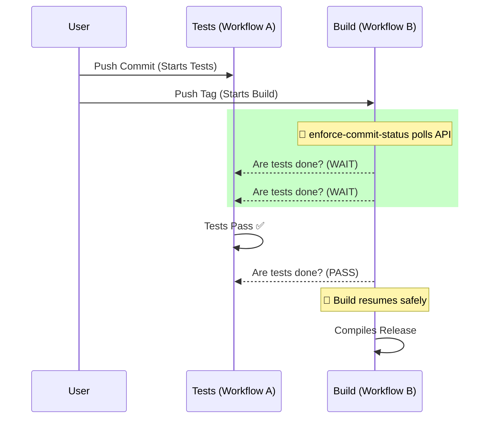

# Enforce Commit Status

[](https://github.com/VitaliiLazebnyi/enforce-commit-status/actions/workflows/ci.yml)
[](LICENSE)

A synchronous gatekeeper action that suspends your GitHub Actions runner until a specific workflow (like your test suite) completes on the target commit.

## Why Use This Action?

In highly decoupled architectures, you might have separate workflows for distinct lifecycle events:

- **Workflow A (Tests)**: Executes automatically whenever a commit is pushed.
- **Workflow B (Build/Deploy)**: Executes automatically whenever a Git Tag is created.

**The Problem**: Tag creation is completely asynchronous from test execution. If you push a commit and immediately push a tag, Workflow B will begin building and deploying your code _before_ Workflow A has actually finished validating the tests. This creates a race condition where you might accidentally release broken code.

**The Solution**: `enforce-commit-status` acts as a synchronous gatekeeper. By dropping this action into the very first step of Workflow B, it will safely poll the GitHub API and suspend the build until Workflow A explicitly returns a `success` conclusion for that specific commit. If the tests fail or time out, the build is immediately halted.



## How to Use It

Drop the `enforce-commit-status` action into your build or deployment workflow before any compilation steps occur.

```yaml
name: Release Build
on:
  push:
    tags:
      - 'v*.*.*'

permissions:
  actions: read
  contents: read

jobs:
  verify-and-build:
    runs-on: ubuntu-latest
    steps:
      - name: Checkout Code
        uses: actions/checkout@v4

      - name: Await Test Workflow Completion
        uses: VitaliiLazebnyi/enforce-commit-status@v1
        with:
          workflow-id: 'tests.yml' # The filename of your test workflow
          poll-interval: '15s' # How frequently to poll the API
          timeout: '45m' # Maximum time to wait before failing

      - name: Build and Deploy
        run: npm run build
```

> **Version pinning**: `@v1` refers to the floating major release tag. Until the first `v1` release is published, pin `@main` or a full commit SHA. Security-conscious consumers should always pin a full commit SHA (e.g. `VitaliiLazebnyi/enforce-commit-status@<sha>`).

### Permissions

The action reads workflow runs via the REST API, so the token needs:

- `actions: read` — required for `GET /repos/{owner}/{repo}/actions/workflows/{id}/runs`.
- `contents: read` — required for annotated-tag resolution via the Git Database API.

The default `${{ github.token }}` is used automatically; the `github-token` input only needs to be set explicitly if you want a different token. If your repository restricts the default `GITHUB_TOKEN` permissions, add the `permissions` block shown above or the action fails with a 403/404.

Tag resolution happens entirely through the API — no checkout (and no `fetch-depth` tuning) is required by this action itself; the checkout step in the example only serves the subsequent build steps.

## Inputs

| Input           | Required | Default               | Description                                                                                                                                        |
| --------------- | -------- | --------------------- | -------------------------------------------------------------------------------------------------------------------------------------------------- |
| `workflow-id`   | **Yes**  | -                     | Filename or ID of the Tests workflow (e.g., `tests.yml`).                                                                                          |
| `commit-sha`    | No       | `${{ github.sha }}`   | Target Commit SHA (full 40- or 64-character hash). Annotated tags are automatically resolved to their underlying commit.                           |
| `github-token`  | No       | `${{ github.token }}` | Authentication token for the Actions API. Requires `actions:read` (and `contents:read` for annotated-tag resolution).                              |
| `poll-interval` | No       | `15s`                 | Polling frequency. Accepts duration strings (e.g., `10s`, `1m`). Minimum: `10s` (lower values are clamped with a warning).                         |
| `timeout`       | No       | `1h`                  | Maximum suspension duration before failing the step. Accepts duration strings (e.g., `45m`, `2h`). Invalid or non-positive values fail the action. |

Durations are capped at ~24.8 days (Node's `setTimeout` limit).

## Outputs

| Output         | Description                                                                                                                                                        |
| -------------- | ------------------------------------------------------------------------------------------------------------------------------------------------------------------ |
| `final-status` | Resolved conclusion: `success`, `failure`, `timeout`, or `error` (the action itself failed — bad input, auth error, unknown workflow — before reaching a verdict). |
| `run-url`      | HTML URL of the matched test run. Also set on timeout when a run was observed; empty if no run was ever matched.                                                   |

## Behavior Notes

- **Run selection**: when multiple runs exist for the same commit, the most recent run (by `created_at`, tie-broken by run id) is evaluated. The list endpoint already reflects only the latest attempt of each run.
- **Fail-closed evaluation**: any completed conclusion other than `success` (including `neutral`, `skipped`, `cancelled`, `startup_failure`, …) fails the gate.
- **API resilience**: HTTP 5xx, 429, and rate-limit 403 responses are retried on the next interval, honoring `retry-after` / `x-ratelimit-reset` headers when present.

## Additional Documentation

Please refer to [`REQUIREMENTS.md`](REQUIREMENTS.md) for the complete, codified technical specification and state matrix logic. Contributions are welcome — see [`CONTRIBUTING.md`](CONTRIBUTING.md).

## License

[MIT](LICENSE)
